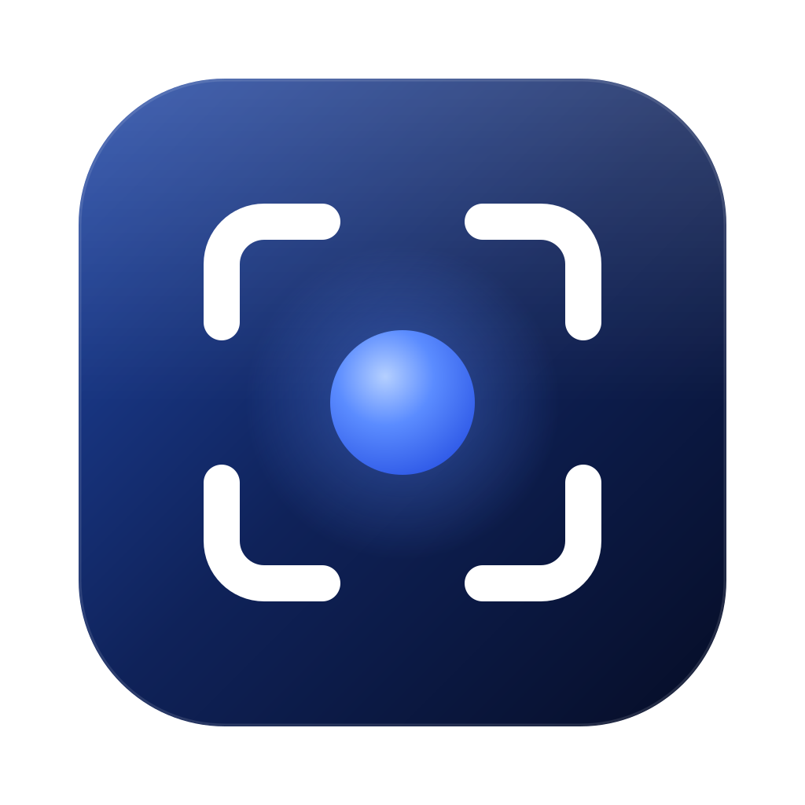

<p align="center"></p>

# FrameLy

Screen recording and screenshots for macOS and Windows, with transcription, summaries and topics
by AI that can run entirely on your computer.

**[Website](https://steinertruthy.github.io/frame-ly/)** ·
**[Download](https://github.com/steinertruthy/frame-ly/releases/latest)** ·
**[What's new](CHANGELOG.md)** · [MIT](LICENSE) license

> *Português:* o FrameLy grava a tela, tira screenshots e transcreve gravações no próprio
> computador, com resumos e tópicos por IA. Veja o [site](https://steinertruthy.github.io/frame-ly/).

## What it does

- **Screenshots** of the screen, a window or a region, marked up right on the selection (arrows,
  shapes, text, highlight, blur, crop, undo/redo).
- **Screen recording** with system audio and microphone, pause, countdown, H.264/HEVC.
- **Transcription** on device (whisper.cpp) with language detection, word timing and export to
  TXT, SRT, VTT, Markdown and PDF.
- **Summaries and topics** with FrameLy AI Cloud (default: free, no account or key, daily limit),
  FrameLy AI Local (llama.cpp), Apple Intelligence (macOS 26+) or your own Anthropic/OpenAI key —
  always with consent before any text leaves the computer.
- Quick panel, library, global shortcuts, a command line, and a UI in five languages
  (pt-BR, en, es, fr, de).

| | Requirement |
|---|---|
| macOS | 14 (Sonoma) or later, Apple Silicon |
| Windows | 10 22H2 or later, x64 (11 recommended) |

Installers aren't signed by Apple/Microsoft yet — see [docs/signing.md](docs/signing.md).

## Run it from source

```bash
pnpm install
pnpm tauri dev
```

Toolchain (Rust, Node 22, pnpm 10, Xcode, cmake/ninja), tests and the command line:
[docs/development.md](docs/development.md).

## Documentation

| Doc | Covers |
|---|---|
| [AGENTS.md](AGENTS.md) | Start here: rules, commands and the doc map (for people and AI agents) |
| [docs/architecture.md](docs/architecture.md) | Layers, data flows, where each thing lives |
| [docs/development.md](docs/development.md) | Toolchain, build, run, tests, CLI, env vars |
| [docs/contributing.md](docs/contributing.md) | Code standards, errors, logs, tests, commits, checklists |
| [docs/platform-macos.md](docs/platform-macos.md) · [docs/platform-windows.md](docs/platform-windows.md) | Native engines and their pitfalls |
| [docs/ai.md](docs/ai.md) | FrameLy AI: transcription, models, providers, consent |
| [docs/ui.md](docs/ui.md) · [docs/settings.md](docs/settings.md) | Interface, i18n, settings and migrations |
| [docs/release.md](docs/release.md) · [docs/signing.md](docs/signing.md) | Versioning, workflows, updater, installer |
| [docs/cloud.md](docs/cloud.md) · [docs/website.md](docs/website.md) | FrameLy AI Cloud service, website |
| [docs/troubleshooting.md](docs/troubleshooting.md) | Logs, crashes, known problems |
| [docs/roadmap.md](docs/roadmap.md) | Stages and known limitations |

## Repository

| Folder | Contents |
|---|---|
| `src/` | UI: Svelte 5 + TypeScript; one HTML entry per window in `src/windows/` |
| `src-tauri/` | Rust: Tauri app, shared core, Windows engine, `llm-worker/` sidecar, NSIS installer |
| `native/macos/FrameLyKit/` | macOS media engine (Swift package) |
| `cloud/` | FrameLy AI Cloud (Cloudflare Worker) |
| `website/` | Official site (Astro, GitHub Pages) |
| `scripts/` | Dev, build and release helpers |
| `.github/workflows/` | CI, release, website, installer screens, updater end-to-end |
